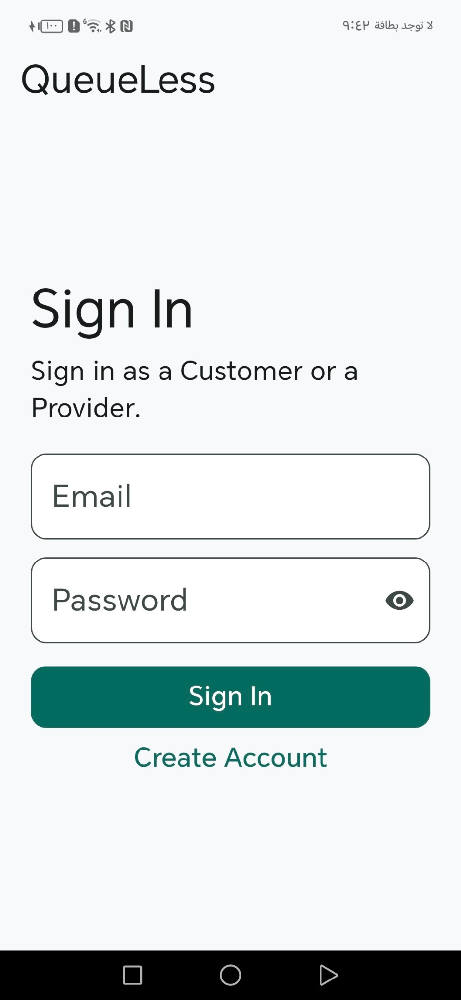
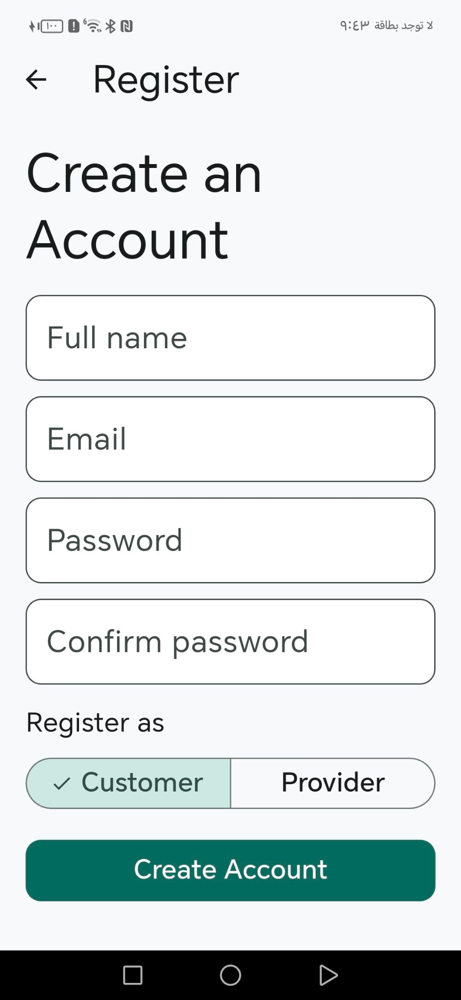
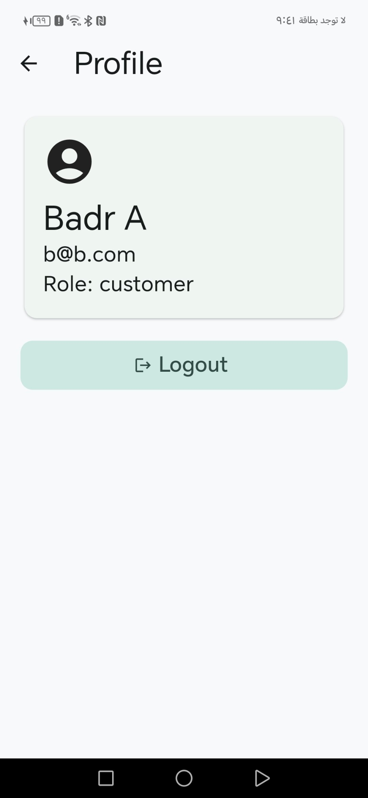
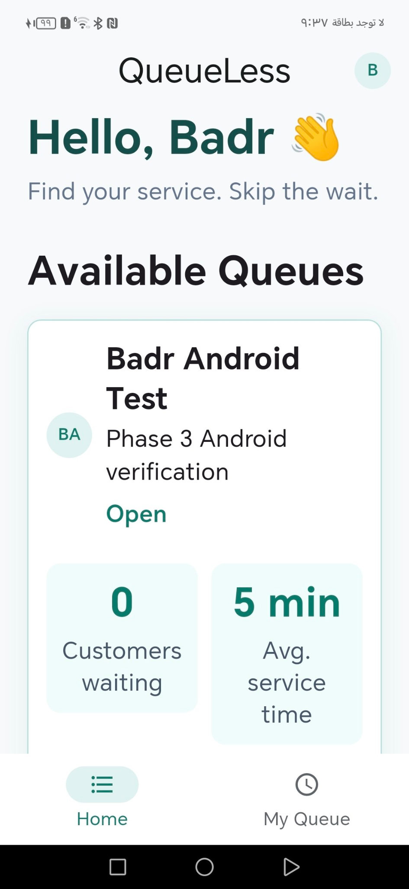
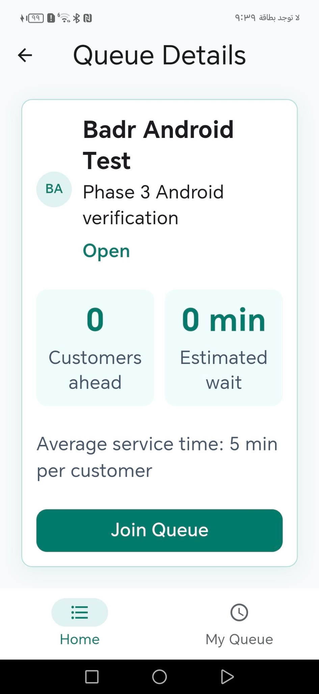
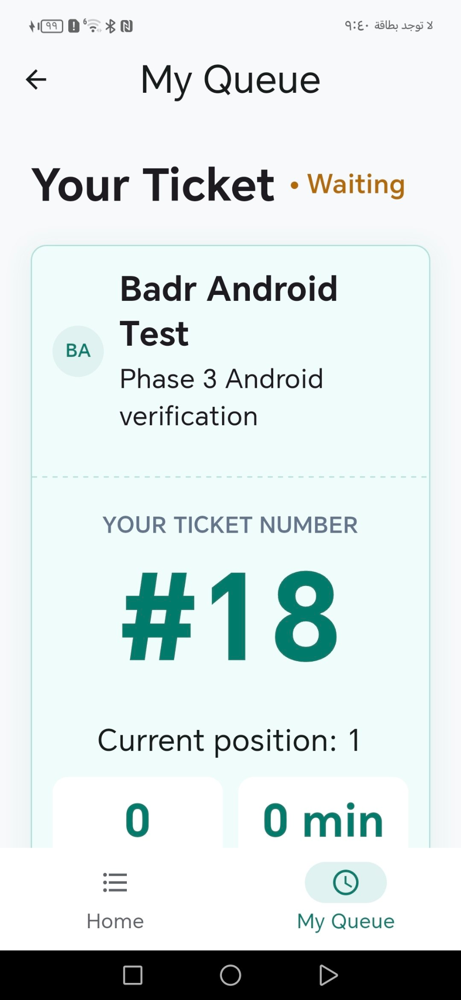
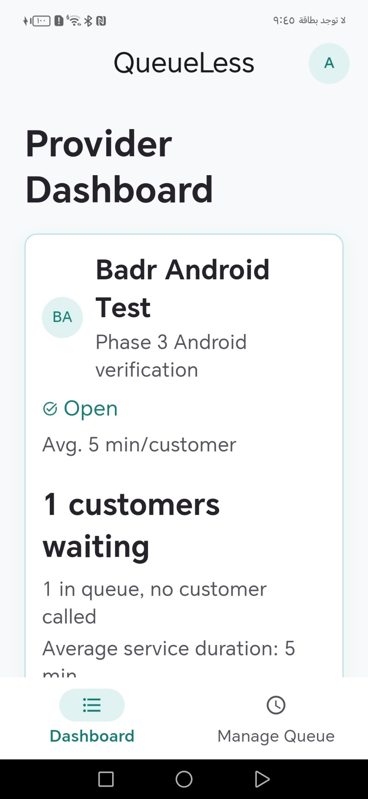
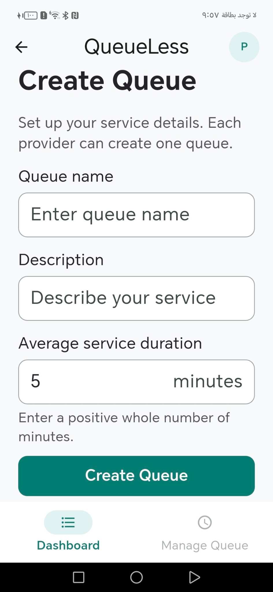
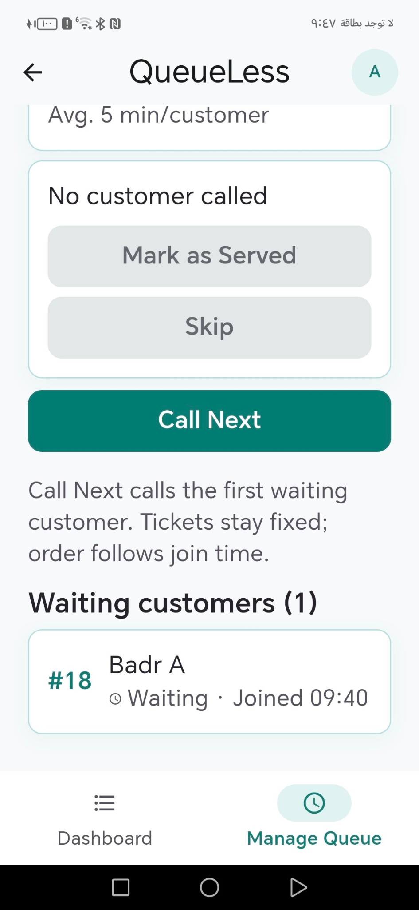

# QueueLess

**SWE 463 | Group 7 | Phase 4: Final Application — Release verified; final submission preparation**

QueueLess is a Flutter virtual queue application. Customers browse services, join or leave a queue, and track their ticket, customers ahead, estimated wait, and turn status. Providers create a queue, view waiting customers, call the next customer, and mark the called customer as served or skipped.

The current application uses Firebase Authentication, Cloud Firestore, Provider, and Firebase Cloud Messaging. Near-turn and called alerts appear inside the application. Android background push delivery was verified using a local trusted Node.js sender while the Firebase project remained on Spark. The sender must stay running and connected; Cloud Functions have not been deployed. See [Local notification setup and verification](docs/local_notifications.md).

## Current submission APK

The current `Group07_QueueLess.apk` was built from application source
`a11efd5`, after Dart formatting and removal of diagnostic debug logging.

The updated release-mode APK was installed and launched successfully
on the physical HONOR NTH NX9 (Android 13), restoring the saved account.
A new ticket #1 in Phase 4 Release Test completed
Join → Call Next → Served, with account switching on the same device.

SHA-256:

```text
8BE72DDE46C22CF374EC2FDF376888D81AB81FB26930BFA7C7B8CB3839501F2E
```

See [release verification](docs/final_release_verification.md).
The screenshots and detailed c94338e checks below are earlier evidence;
their APK hash identifies the previous build.

## Earlier release verification — c94338e — 28 November 2026

Application source `c94338e` was verified from a clean checkout on the
existing configured Windows machine:

- `flutter analyze`: no issues found.
- `flutter test`: all 147 tests passed.
- Release-mode APK built, installed and launched on a physical
  HONOR NTH NX9 running Android 13.
- Saved customer session restoration, join, leave cancellation and
  confirmation, rejoin, Call Next, Served and Skip were verified.
- Provider sign-in and Call Next also worked on the Android release APK.
- New provider registration, queue-form validation and queue creation
  were verified.
- Called background notification delivery succeeded with the trusted
  local sender running.

Artifact: `Group07_QueueLess.apk` (approximately 50.1 MB).

SHA-256:
`48EF4DF67DD8C007DCABE7FF8C7B8FBECA12C7A0DF6D835E57C1F99C40EB1FB3`

The APK uses the repository's debug signing configuration in release
mode; store signing is not claimed. Cloud Functions were not deployed.

See [Final release verification](docs/final_release_verification.md)
for test details, build environment adjustments and verification limits.

The `final-submission` tag is pending the final repository checks.
Earlier dated verification records below describe their stated revisions.

## Team

| Member | Student ID | Assigned area |
| --- | --- | --- |
| Abdulrahim Albijadi | 202260760 | Authentication, Firebase data integration, and profile |
| Omar Alshehri | 202177130 | Provider dashboard and queue management |
| Bader Alshehri | 202178070 | Customer interface and navigation |
| Bader Almutairi | 202159390 | Queue rules, waiting estimates, and notifications |

### Phase 4 contribution evidence

| Member | Completed work | Evidence |
| --- | --- | --- |
| Abdulrahim Albijadi | Firebase configuration, account/session handling, transactional queue operations, Firestore rules and backend emulator scenario. | [Backend commit](https://github.com/Abdulrahim-Albijadi/SWE463-Group7-Project/commit/a83fcb2), [Firebase evidence](docs/phase4_firebase_evidence.md) |
| Omar Alshehri | Provider dashboard, queue creation/management, validation, action safety, responsive layouts and provider tests. | [PR #17](https://github.com/Abdulrahim-Albijadi/SWE463-Group7-Project/pull/17), [Provider evidence](docs/provider_testing.md) |
| Bader Alshehri | Customer navigation and ticket safety, responsive UI/tests, local sender integration, live verification, release APK checks and report preparation. | [PR #18](https://github.com/Abdulrahim-Albijadi/SWE463-Group7-Project/pull/18), [PR #21](https://github.com/Abdulrahim-Albijadi/SWE463-Group7-Project/pull/21), [PR #23](https://github.com/Abdulrahim-Albijadi/SWE463-Group7-Project/pull/23), [Release verification](docs/final_release_verification.md) |
| Bader Almutairi | Shared queue rules, waiting estimates, notification permission/token handling and server notification logic/tests. | [PR #19](https://github.com/Abdulrahim-Albijadi/SWE463-Group7-Project/pull/19), [PR #20](https://github.com/Abdulrahim-Albijadi/SWE463-Group7-Project/pull/20), [Notification evidence](docs/local_notifications.md) |

## Current feature progress

| ID | Approved essential feature | Status | Current behavior |
| --- | --- | --- | --- |
| F1 | Accounts and roles | Implemented | Firebase email/password registration and sign-in, Customer/Provider roles, profile display, role-specific navigation, and logout. |
| F2 | Queue creation and management | Implemented | Create one queue per provider; display waiting customers; Call Next, Mark as Served, and Skip. |
| F3 | Join and leave | Implemented | Browse queues, view details, join, leave with confirmation while waiting, and rejoin with a new ticket. |
| F4 | Live queue tracking | Implemented | Firestore snapshot subscriptions update queue and membership data; screens display ticket and status information. Live updates between independent Chrome profiles are documented in [Provider verification](docs/provider_testing.md); simultaneous use on two physical devices remains unverified. |
| F5 | Estimated waiting time | Implemented | Customers ahead multiplied by the provider's average service duration; the called customer counts as ahead. |
| F6 | Queue notifications | Implemented with local sender | In-app alerts, FCM token registration, and a trusted local sender are implemented. Near-turn and called background notifications were verified on Android. Automatic sending requires the local process to remain running; hosted Cloud Functions are not deployed. |

All six essential features have implementations. F6 currently depends on the documented local sender. The documented emulator concurrency checks passed; remaining release verification is listed below.

QR joining, Queue History, Pause/Close Queue, and Basic Queue Statistics were excluded optional features in the approved Phase 2 scope. They are not claimed as implemented core features.

## Screens and navigation

The application has nine major screens:

- Shared: Login, Register, and Profile.
- Customer: Customer Home, Queue Details, and My Queue.
- Provider: Provider Dashboard, Create Queue, and Queue Management.

Customer flow: Login/Register → Customer Home → Queue Details → Join Queue → My Queue. Home and My Queue are accessible through bottom navigation.

Provider flow: Login/Register → Provider Dashboard → Create Queue → Queue Management. Dashboard and Manage Queue are accessible through bottom navigation. Shared Profile provides account information and logout confirmation.

## Final Android screenshots

Captured from the installed release-mode APK on a physical
HONOR NTH NX9 (Android 13), 28 November 2026.
Some screenshots show scrolled views.

| Login | Register | Profile |
| --- | --- | --- |
|  |  |  |

| Customer Home | Queue Details | My Queue |
| --- | --- | --- |
|  |  |  |

| Provider Dashboard | Create Queue | Queue Management |
| --- | --- | --- |
|  |  |  |

Additional captures show
[Called](docs/evidence/release_android/my_queue_called.png),
[Served](docs/evidence/release_android/my_queue_served.png),
[registration validation](docs/evidence/release_android/register_validation.png),
[queue validation](docs/evidence/release_android/queue_validation.png),
[no queue yet](docs/evidence/release_android/provider_no_queue.png)
and [successful creation](docs/evidence/release_android/queue_created.png).

See [screenshot sources](docs/evidence/release_android/README.md).

## State management and data

`AppProviders` supplies `AuthProvider`, `QueueProvider`, `MembershipProvider`, `ProviderQueueProvider`, and `PushProvider`. Authentication changes bind providers to the current user. `PushProvider` handles customer notification permission and FCM token registration. Temporary form and interaction state uses local `setState` and controllers.

`main.dart` initializes Firebase with `DefaultFirebaseOptions.currentPlatform` and injects `FirebaseAuthRepository` and `FirebaseQueueRepository`. The in-memory repositories remain available for isolated tests; normal application startup uses Firebase.

| Data | Current source |
| --- | --- |
| Credentials | Firebase Authentication |
| User name, email, and role | Firestore `users/{uid}` |
| Provider queue | Firestore `queues/{providerUid}` |
| Customer ticket and membership status | Firestore `entries/{entryId}` |
| Customers ahead and estimated wait | Derived from queue entries and average service duration |
| Near-turn/called messages | In-app membership alert stream and screen state |

Passwords are handled by Firebase Authentication and are not written to the application's Firestore collections. Firestore entries are stored in a top-level `entries` collection, rather than the nested collection proposed in Phase 2.

### Queue rules

- A customer may have one active membership; a provider may create one queue.
- A successful join creates a waiting entry with a fixed ticket number.
- Queue order follows joining time; a ticket number stays fixed as customers ahead change.
- Leave is allowed while waiting and changes the status to `left`.
- Call Next calls the first waiting customer; only one customer may be called at a time.
- Only the called customer can be marked `served` or `skipped`.
- Serving or skipping does not automatically call the next customer.
- `estimatedWait = customersAhead × averageServiceMinutes`.
- The currently called customer counts as ahead until served or skipped.
- A waiting customer's turn is near when two or fewer active customers are ahead.

## Setup and run

### Prerequisites

- Flutter with a bundled Dart SDK satisfying `^3.13.1`, as declared in `pubspec.yaml`.
- For the verified Android path: an Android development toolchain and an emulator or USB-debugging-enabled physical device.
- Internet access and access to the configured Firebase project, or an appropriately configured replacement Firebase project.
- Firebase configuration matching the selected target platform. Obtain the client configuration from the team's Firebase project. Put the Android `google-services.json` in `android/app/` and the iOS `GoogleService-Info.plist` in `ios/Runner/` when building those platforms.
- Firebase Authentication with Email/Password enabled and a Cloud Firestore database with the intended access rules. A team member with Firebase project access must confirm the configuration for a fresh environment.

Create an ignored `firebase.local.json` at the repository root. Include the keys for the platforms you build.

```json
{
  "QUEUELESS_FIREBASE_WEB_API_KEY": "<web apiKey>",
  "QUEUELESS_FIREBASE_ANDROID_API_KEY": "<Android current_key>",
  "QUEUELESS_FIREBASE_IOS_API_KEY": "<iOS API_KEY>"
}
```

The Android package used in the manual run was `com.example.swe463_group7_project`. If the configured API key restricts Android applications, its allowed package and signing-certificate fingerprint must match the build. Firebase client keys identify the project. Authentication and Firestore rules control data access. Keep keys scoped to the Firebase APIs the app uses. [Firebase API key documentation](https://firebase.google.com/docs/projects/api-keys)

From the repository root:

```bash
flutter pub get
flutter analyze
flutter test
flutter devices
flutter run -d <device-id> --dart-define-from-file=firebase.local.json
```

Replace `<device-id>` with an ID reported by `flutter devices`. Android on a physical HONOR device is manually verified. A separate clean checkout at `7cdd0a0` passed dependency resolution, analysis, its then-current 69 tests, Android build/install/start, Firebase sign-in, and a queue read on the same configured machine. At `4d87822`, analysis, all 81 tests, and an Android Provider Dashboard/Manage Queue smoke check passed. The latter revision was not retested in a second clean clone. Omar's archived evidence also documents live Firebase operation in Chrome; see [Provider verification](docs/provider_testing.md).

### Test accounts

Create new test accounts through **Create Account** using distinct email addresses and select the required Customer or Provider role. Keep passwords private.

The sign-in fields start empty. Use the registered Firebase account to sign in.

## Testing instructions

Run the backend test in Chrome against local Firebase Authentication and Firestore emulators. The test covers session state, concurrent joins, and simultaneous provider operations. It uses the demo project and starts with empty emulator data.

See the [Phase 4 Firebase contribution and verification evidence](docs/phase4_firebase_evidence.md).

```bash
firebase emulators:exec --only auth,firestore --project demo-queueless-phase4 \
  'flutter test --no-pub --platform chrome --dart-define=QUEUELESS_FIREBASE_EMULATOR=true test/firebase_join_emulator.dart'
```

Use a dedicated provider queue to avoid changing another team member's demonstration data. Example setup: queue name `Badr Android Test`, description `Phase 3 Android verification`, and average service duration `5` minutes. Ticket numbers depend on existing activity; the examples below assume a new, empty queue.

1. Register a Provider and create the test queue. Confirm that its dashboard shows the queue and no waiting customers.
2. Log out, register a Customer, open the queue, and join. Confirm a waiting ticket and the My Queue screen.
3. Choose Leave Queue, cancel the confirmation, and confirm the ticket remains. Then confirm leaving and check the `left` state. Rejoin and confirm a new ticket.
4. Switch to the Provider account, open Manage Queue, and choose Call Next. Switch back to the Customer and confirm `called` and the turn message.
5. Mark that ticket as served from the Provider account. Confirm `served` and the completion message in the Customer account.
6. Rejoin and repeat Call Next followed by Skip. Confirm `skipped` and the missed-turn message in the Customer account.
7. For the estimate test, start with no active entries. Join using three distinct Customer accounts, logging out between accounts without leaving their queues. On the third account, confirm two customers ahead, a 10-minute estimate, and the near-turn notice.
8. Call and serve the first customer. On the third account, confirm its ticket number stays fixed while the count becomes one ahead and the estimate becomes 5 minutes.
9. Call the second customer without serving them. Confirm the third account still shows one ahead and 5 minutes. Serve the second customer; the third account should remain waiting with zero ahead and zero minutes until Call Next is explicitly used.
10. Verify logout and account switching return to the expected screens without a stale profile-listener error.

Switching accounts on one device verifies persisted results across sessions. Omar's [live workflow records](docs/evidence/logs/live-workflow.json) document updates between independent Chrome profiles without refreshing. These browser sessions do not establish simultaneous operation on two physical devices.

### Recorded validation

Latest integration verification on **27 November 2026**, after backend update `42667d8`:

- `flutter analyze`: no issues found.
- Standard Flutter suite: **147 tests passed**.
- Chrome queue-rule suite: **16 tests passed**.
- Separate Firebase emulator integration scenario passed with exit code 0.
- Updated Firestore rules were deployed successfully to `queueless-group7`.
- Updated Android customer and Chrome provider sessions verified join, call, serve, skip, leave, rejoin, and live status updates.
- Saved customer session restoration and called background notification delivery were verified on Android.
- Browser tests required a documented local Flutter SDK correction for CanvasKit URL handling on Windows.
- See [Backend and integration verification](docs/phase4_firebase_evidence.md#integration-verification--27-november-2026) for details and remaining release work.


Earlier verification on **27 November 2026**, before backend update `42667d8`, using Flutter 3.47.9:

- `flutter analyze`: no issues found.
- `flutter test`: all **144 tests passed**.
- `node --check functions/local_sender.js`: passed.
- Notification logic tests: all **22 passed**.
- Android customer and Chrome provider sessions verified near-turn and called background notifications for ticket #10, followed by Called and Served screen updates.
- Delivery used the local sender with one configured queue and customer. Cloud Functions were not deployed.
- See [Local notification setup and verification](docs/local_notifications.md) for commands, prerequisites, and limitations.

Earlier verification on **14 November 2026**, at main revision **`4d87822`** after PR #15:

- `flutter analyze`: no issues found.
- `flutter test`: **all 81 tests passed**. This includes the existing 78 tests and three relocated Provider workflow tests; routine execution does not regenerate archived screenshots.
- The application ran on the physical HONOR device. Provider Dashboard and Manage Queue displayed their data and navigation worked after the Provider screen separation.
- Main was synchronized with `origin/main`; the three generated macOS/Windows plugin-file changes remained local and outside the reviewed commits.

Earlier checks on **13 November 2026**:

- A separate clone at `7cdd0a0` passed `flutter pub get`, analysis, all then-existing 69 tests, Android build/install/start, Firebase sign-in, and a queue read on the existing configured machine.
- The Provider loading/recovery fix added nine regression tests; all 78 tests passed before PR #14 was merged. Provider Dashboard and Manage Queue also passed the subsequent Android smoke check at `7872f70`.
- Firebase registration for both roles, provider queue creation, logout, and account switching succeeded.
- Join, cancel/confirm leave, rejoin, called, served, and skipped flows succeeded.
- Three-customer checks confirmed 2 ahead → 10 minutes, 1 ahead → 5 minutes, and 0 ahead → 0 minutes with a fixed ticket number.
- The called customer remained included in customers ahead; serving did not automatically call the next customer.
- Near-turn and called in-app messages were observed.
- Staged diff checks passed for the reviewed fixes and documentation changes.

Omar's original **12 November 2026** browser/Firebase evidence documents independent Customer/Provider sessions, live updates without refreshing, and queue/terminal-ticket persistence after reload and explicit sign-in. The later organization work and its logs are described in [Provider testing](docs/provider_testing.md). Historical failures remain in the archived logs; later passing results are recorded separately.

These results apply to the stated revisions and environments. Saved customer session restoration was verified on the tested Android device. A clean checkout at c94338e was verified on 28 November 2026. The eventual final tagged revision still requires its final checks; setup on a completely new development machine remains unverified. Rerun relevant checks after further code changes.

## Loading, empty, validation, and failure states

The inspected provider screens include loading and load-error states with Retry, no-queue and no-waiting-customer states, required queue-field and positive-duration validation, creating/busy states, and action success/failure feedback. The inspected authentication screens include required-field checks, password confirmation, busy controls, and failure text. Customer empty, waiting, near-turn, called, served, skipped, and left states were observed during manual testing.

## Known issues and remaining work

- **Push notification hosting:** Android background delivery is verified with the local sender. It requires a running, connected laptop and is restricted to the configured test queue and customer. Always-on hosting, recovery after interruption, foreground system notifications, and notification-tap routing remain unverified.
- **Phase 4 rollout:** updated Firestore rules were deployed on 27 November 2026 and the updated application passed the documented live workflow checks. Use the matching updated application; older clients do not perform the synchronized writes required by these rules. The release APK was built, installed and exercised on 28 November 2026; see docs/final_release_verification.md.
- **Fresh setup:** a clean checkout at `7cdd0a0` ran successfully on the existing configured Android development machine. A clean checkout at c94338e passed analysis, all 147 standard tests and release APK build/install checks on the existing configured machine on 28 November 2026. Setup on a completely new machine or signing key remains unverified; Firebase configuration and Android application restrictions must match that environment.
- **Multiple devices/platforms:** live Firebase operation across independent Chrome profiles is documented in the archived Provider evidence. Simultaneous operation on two physical devices and native iOS/desktop builds remain unverified.
- **Failure-path verification:** controlled network failures and all retry/validation variants have not been manually exercised in the recorded session.
- **Submission evidence:** finalize the Phase 4 report, screenshots and contribution evidence, run the final repository checks, and create the `final-submission` tag only when the final submitted revision is ready.

## Project structure

| Path | Purpose |
| --- | --- |
| `lib/main.dart` | Firebase startup, theme, routes, authentication/profile screens, and in-app alert display |
| `lib/firebase_options.dart` | Platform-specific Firebase client configuration |
| `lib/models/queue_data.dart` | User, queue, membership, and notification models |
| `lib/logic/queue_rules.dart` | Queue checks, ordering, and derived queue logic |
| `lib/providers/` | Shared authentication, queues, membership, and provider state |
| `lib/repositories/repositories.dart` | In-memory repository implementations for isolated testing |
| `lib/repositories/firebase_auth_repository.dart` | Firebase Authentication and Firestore profile integration |
| `lib/repositories/firebase_queue_repository.dart` | Firestore queue and membership reads/writes and subscriptions |
| `lib/screens/customer/` | Separate Customer Home, Queue Details, and My Queue screens |
| `lib/screens/customer_screens.dart` | Compatibility exports for the Customer screens |
| `lib/screens/provider/` | Separate Provider Dashboard, Create Queue, and Queue Management screens |
| `lib/screens/provider_screens.dart` | Compatibility exports for existing Provider screen imports and routes |
| `lib/widgets/customer/` | Reusable customer interface widgets |
| `lib/widgets/provider/` | Reusable provider interface widgets |
| `test/` | Automated Flutter tests |
| `docs/` | [Documentation index](docs/README.md), Provider report and testing records, screenshots, and verification logs |

## Packages

| Package | Declared constraint | Purpose |
| --- | --- | --- |
| Flutter SDK | SDK | Material interface, navigation, and framework |
| `cupertino_icons` | `^1.0.8` | Cupertino icon assets |
| `provider` | `^6.1.5+1` | Shared state and dependency injection |
| `firebase_core` | `^5.1.0` | Firebase initialization |
| `firebase_auth` | `^7.0.1` | Email/password authentication |
| `cloud_firestore` | `^7.1.0` | Stored profiles, queues, entries, and snapshot updates |
| `firebase_messaging` | `^17.1.0` | FCM permission, device token registration, and push notification delivery |
| `flutter_test` | SDK | Automated tests |
| `flutter_lints` | `^6.0.0` | Static analysis rules |

These are `pubspec.yaml` constraints; `pubspec.lock` records resolved versions. Server dependencies are declared separately in `functions/package.json`. Cloud Functions source is included, but deployment is pending; the verified Spark-compatible delivery path uses `functions/local_sender.js`.

## Links and references

- [Figma designs](https://www.figma.com/design/sVVahJW10wMCvfVPgKibRQ/QueueLess-Phase-2?node-id=0-1)
- [GitHub repository](https://github.com/Abdulrahim-Albijadi/SWE463-Group7-Project)
- [Flutter documentation](https://docs.flutter.dev)
- [Provider package](https://pub.dev/packages/provider)
- [Firebase Authentication](https://firebase.google.com/docs/auth)
- [Cloud Firestore](https://firebase.google.com/docs/firestore)
- [Firebase Cloud Messaging](https://firebase.google.com/docs/cloud-messaging)
- [Cloud Functions Firestore triggers — source included, not deployed](https://firebase.google.com/docs/functions/firestore-events)
- [Local notification sender setup and verification](docs/local_notifications.md)

## Licenses and AI use

During Phase 4, Codex assisted with account-state debugging, sign-in and session routing, Firestore transaction and rules changes, Firebase configuration, emulator testing, and drafting the backend verification and contribution evidence.

Retain third-party notices and review the LICENSE files for the resolved package versions before distribution. The Phase 2 reference record identifies Flutter as BSD 3-Clause, Provider as MIT, Material Icons as Apache License 2.0, Firebase documentation content as CC BY 4.0 with code samples under Apache License 2.0, and Figma as subject to its terms of service. Documentation licenses do not replace package licenses or Firebase service terms.

The team made the design and product decisions and is responsible for understanding and reviewing the submitted work. Figma AI and ChatGPT were used for some screen drafts, Flutter starter code examples, and suggestions. Claude was used to help structure the Phase 2 report and README and correct grammar. During Phase 3, ChatGPT assisted with debugging the customer smoke-test provider setup and Firebase profile-listener behavior, preparing the Provider loading/stream-recovery fix and nine regression tests, planning manual checks, and drafting this README and the Phase 3 report from supplied code and reported results. Each member must ensure this disclosure also covers any other AI assistance used in their contribution. AI assistance is not evidence of a member's authorship or completed work.

During Phase 4, ChatGPT assisted with customer navigation and ticket-safety fixes, responsive layouts, regression tests, notification integration review, the local sender implementation, manual test guidance, and documentation. The team reviewed and applied the changes; validation results reflect the tests and device checks actually performed.