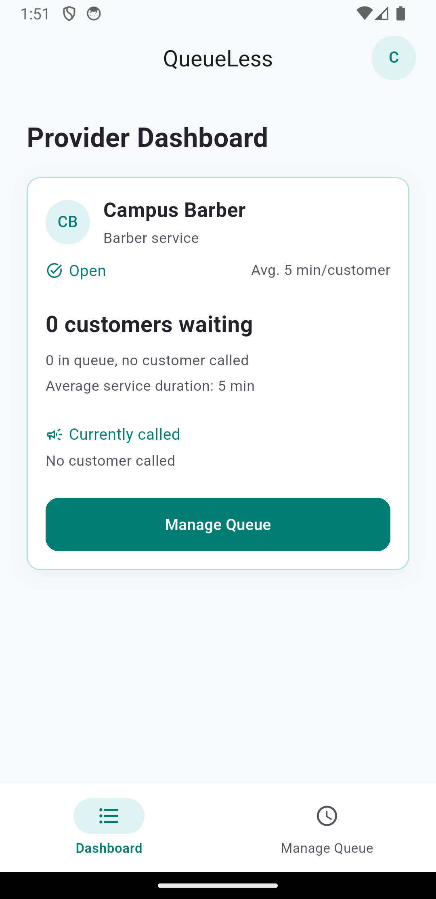
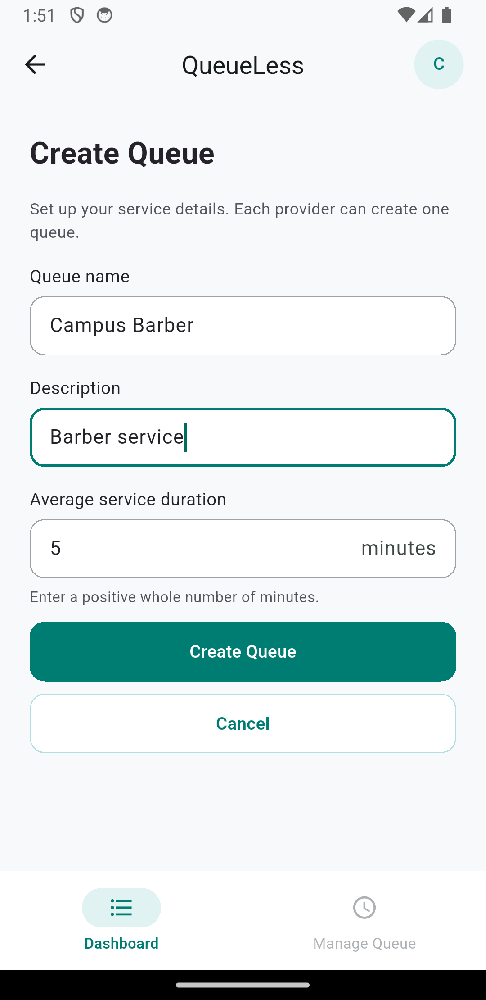
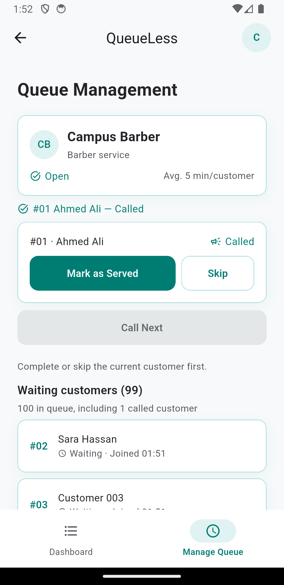
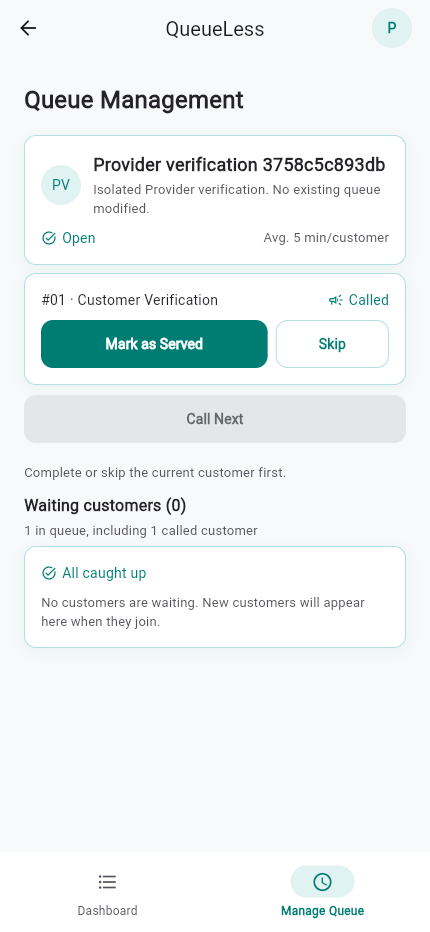
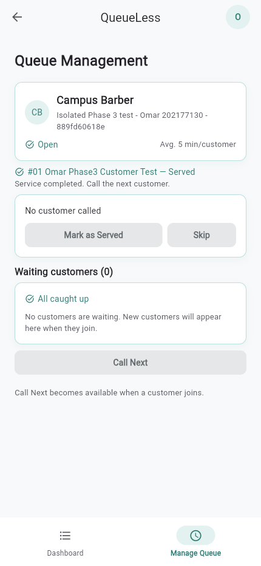
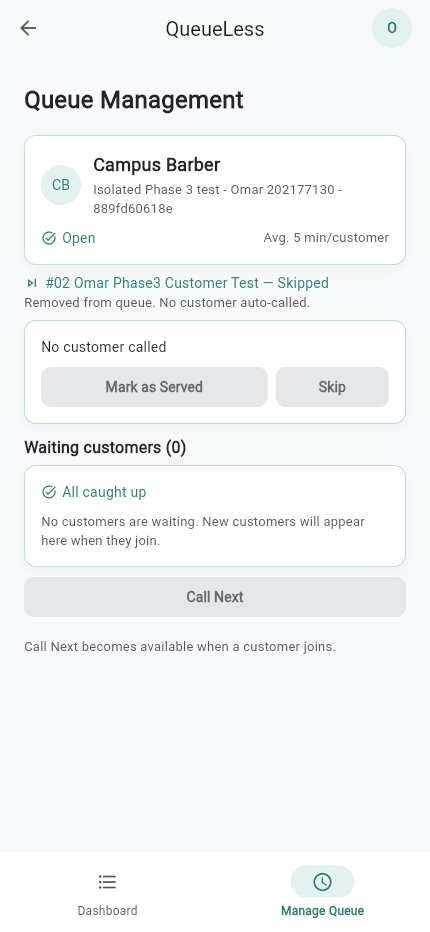
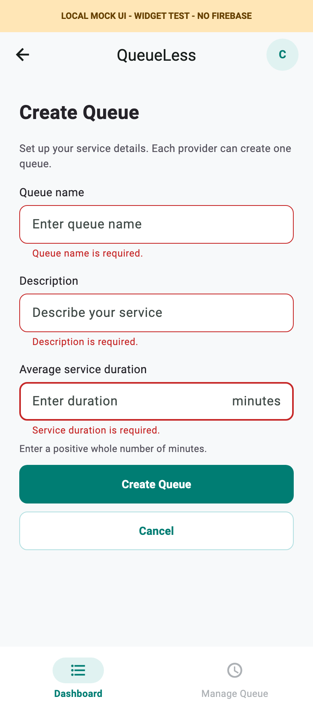
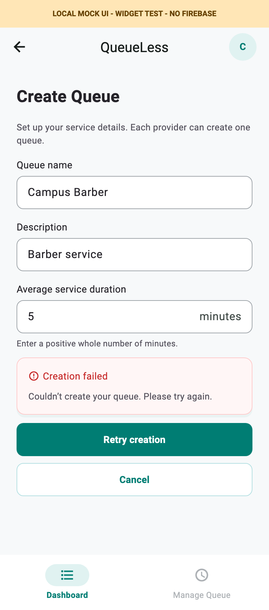

# Provider functionality and verification

## Post-backend integration update — 27 November 2026

After backend update `42667d8` and production Firestore rules deployment, Bader Alshehri verified the updated Chrome provider against a physical Android customer session. Live joining, Call Next, Served, Skipped, leave/rejoin list updates, and called background notification delivery passed. The standard application suite passed all 147 tests. See [Integration verification](phase4_firebase_evidence.md#integration-verification--27-november-2026).

The following 20 November record remains historical evidence for Omar's provider implementation. Its references to uncommitted work and deployment limitations describe that earlier session.

Verified **20 November 2026 (Asia/Riyadh)** on branch `omar`, working tree based on `badb5bc` with uncommitted Provider improvements. This is the primary Provider implementation and testing record. The [root README](../README.md) owns shared application setup and team-wide feature status.

## Final Provider Interface and Testing Evidence

The presentation follows page 7 of `Group07_Phase3_Prototype.pdf`: three equal-width portrait screens in **Provider Dashboard → Create Queue → Queue Management** order, followed by short captions. The original PNGs below are ready to reuse from [the final screenshot directory](evidence/provider_screenshots/final/); keep their aspect ratios and source labels. All existing evidence remains available in the [screenshot manifest](evidence/provider_screenshots_manifest.json).

| Collection | Contents | Selection basis |
| --- | --- | --- |
| [Final screenshots](evidence/provider_screenshots/final/) | **4 images:** three clean Android simulated-data screens and one live Firebase web capture. | Captured from the current implementation on 20 November; all three main screens are available. |
| [Previous screenshots](evidence/provider_screenshots/previous/) | **44 images:** 22 historical live browser captures, 19 simulated widget renders and three original labeled Android captures. | Historical evidence and superseded report images retained for audit; the labeled Android originals still show the final implementation. |

All original filenames and image bytes are preserved. The manifest records each original path and current collection; three fresh clean captures bring the total to **48 images**. Current-version Served, Skipped and validation screenshots are not available; their relevant historical captures are retained below and must not be presented as final-version UI.

Organization verification accounted for all **45 originals**, with unchanged SHA-256 hashes, dimensions and readable PNG data. All local documentation links and `git diff --check` passed. Application code, Firebase files, automated tests and original test logs were unchanged during that organization. The subsequent report recapture added three images without changing those files; no Flutter test results are claimed for the recapture.

### Main Provider interface — final

**Source: genuine Android emulator screenshots with simulated data, 20 November 2026.** These matching 1080×2220 report captures were taken fresh from the current application in Flutter profile mode, using the existing `QueueLessApp`, theme, routes, shared state and in-memory repositories through a temporary ignored capture entry point. No testing banner or controls wrapped the application. The full native status bar, navigation bar, app layout and proportions are retained; no image was cropped, resized, retouched or generated. The temporary entry point was removed after capture.

**These Android images are simulated-data UI evidence, not live Firebase results.** Keep that source label in report captions when reusing them. The original banner-labeled [Dashboard](evidence/provider_screenshots/previous/mock-android-provider-dashboard.png), [Create Queue](evidence/provider_screenshots/previous/mock-android-create-queue.png) and [Queue Management](evidence/provider_screenshots/previous/mock-android-queue-management.png) captures remain unchanged in `previous/` for audit. The fresh fixture uses Campus Barber with a five-minute duration; after creation, 100 local customers were added and Call Next called ticket #01 Ahmed Ali, leaving #02 Sara Hassan first among 99 waiting customers.

Recapture verification passed: all **45 original images** retain their filenames and hashes; all **48 images** decode and match manifest hashes/dimensions; all **61 local Markdown references**, internal anchors and `git diff --check` pass. Only this record, the screenshot manifest and screenshot additions/moves changed. The standard `flutter build apk --debug --no-pub` succeeded afterward to restore the normal production entry point in the debug build output; the emulator was closed. No new Firebase or TalkBack acceptance result is claimed.

| Provider Dashboard | Create Queue | Queue Management |
| :---: | :---: | :---: |
|  |  |  |
| **P1a · Simulated Android.** Service details, waiting count and access to queue management. | **P1b · Simulated Android.** Required service details and a five-minute average duration, before submission. | **P1c · Simulated Android.** Called-customer actions and Call Next above the waiting list; 99 waiting, one called. |
| [Original Dashboard PNG](evidence/provider_screenshots/final/simulated-android-provider-dashboard.png) | [Original Create Queue PNG](evidence/provider_screenshots/final/simulated-android-create-queue.png) | [Original Queue Management PNG](evidence/provider_screenshots/final/simulated-android-queue-management.png) |

### Live Firebase called state — final

**Source: genuine Chrome application screenshot backed by Firebase, 20 November 2026, 430×932.** This final-version capture shows Queue Management after an offline Call Next resumed online. It is a web capture, not native Android evidence. Served and Skip also passed in that live session, but their saved screenshots below are historical.

**P2a · Live, 20 Nov.** Ticket #01 is called; another Call Next remains disabled. [Original Called PNG](evidence/provider_screenshots/final/live-provider-queue-management.png).

### Historical supporting evidence

**Historical live Firebase outcomes, 12 November 2026, 430×932.** These captures come from the earlier isolated Chrome/Firebase workflow and predate the final layout. They are separate from the final-version session above and are retained as evidence of Served/Skipped outcomes.

| Mark as Served — previous version | Skip — previous version |
| :---: | :---: |
|  |  |
| **P2b · Historical live.** Ticket #01 is served; no customer is automatically called. | **P2c · Historical live.** Ticket #02 is skipped; no customer is automatically called. |
| [Original Served PNG](evidence/provider_screenshots/previous/live-provider-served.png) | [Original Skipped PNG](evidence/provider_screenshots/previous/live-provider-skipped.png) |

#### Historical validation and recovery

**Source: simulated widget-test renders, 12 November 2026, 780×1768.** These retained captures show required-field validation and a controlled creation failure. They are not running-app screenshots or real Firebase permission denials; their visible mock banners identify the source. They predate the final accessibility refinements.

| Required input | Creation failure and retry |
| :---: | :---: |
|  |  |
| **P3a · Simulated.** Missing name, description and duration receive individual error messages. | **P3b · Simulated.** A reported creation failure preserves input and offers explicit Retry creation. |
| [Original Validation PNG](evidence/provider_screenshots/previous/mock-create-required-fields.png) | [Original Creation Error PNG](evidence/provider_screenshots/previous/mock-create-queue-error.png) |

### Test results and verification boundaries

These are the **recorded verification results**, not new test runs performed during screenshot selection. Detailed commands and coverage remain below.

| Area | Recorded result |
| --- | --- |
| Automated checks | `flutter pub get`, `flutter analyze`, all **121 tests** (including **67 Provider screen tests**), web build and production debug APK build passed. |
| Live Firebase, Chrome | Queue creation, normal duplicate prevention, live joining, Call Next, Served, Skip and persistence after reload plus explicit sign-in passed with isolated new test accounts. |
| Pending/offline recovery, Chrome | A pending Call Next allowed navigation; reconnect synchronized the result without repeating the write. |
| Permission/network errors | **10 simulated failure regressions passed** using `permission-denied`/`unavailable` exceptions. Actual Firestore permission denial was not verified. |
| Android interface | Native fixture checks covered all three screens, navigation/system Back, action outcomes, scrolling through 100 customers and 320dp/200% text. **Simulated data only.** |
| Accessibility/responsiveness | Widget checks covered announcements/semantics, retry labels, keyboard focus, minimum action targets and all three screens at 280px/250% text. Actual TalkBack interaction remains unverified. |

**Verified Firebase functionality:** the existing Auth/Firestore integration supported the complete Provider workflow in Chrome on 20 November, with updates visible in an independent Customer session. No existing user records, production rules or Firebase configuration were changed. Neither Served nor Skip automatically called another customer.

**Known limitations:** native Android Firebase Authentication rejected the production application with “Requests from this Android client application com.example.swe463_group7_project are blocked.” The Firebase owner must resolve the Android client restriction before native live acceptance. TalkBack was not installed, so no spoken-interaction pass is claimed. Shared error mapping remains generic, and cross-device action atomicity remains unverified; see [remaining limits](#defects-fixed-and-remaining-limits).

### Short demonstration workflow

1. For the live demonstration, use Chrome with separate isolated Provider and Customer accounts. Create a new marked queue with a five-minute duration; confirm creation feedback and the duplicate-queue guard.
2. Join that queue from the Customer session. Open Queue Management and show the live ticket, name and waiting count; Call Next is above the waiting list.
3. Call the customer and show the Called state in both sessions. Mark as Served; rejoin, call again and Skip. Confirm the terminal statuses and that neither action automatically calls another customer.
4. During a controlled Provider-only network interruption, show pending feedback and usable Back/Dashboard navigation. Reconnect and wait for confirmation without repeating the write; reload and explicitly sign in to demonstrate persistence.
5. For Android layout and long-list demonstration, use the explicitly labeled local fixture described in [Android verification](#android-and-talkback-verification). Keep its simulated-data banner visible and explain the native Firebase restriction.

## Final implementation

| Screen | Behavior |
| --- | --- |
| [Provider Dashboard](../lib/screens/provider/provider_dashboard_screen.dart) | Firebase-backed service details, waiting/active counts and currently called customer; loading, empty and load-error states; navigation to creation, management and Profile. |
| [Create Queue](../lib/screens/provider/create_queue_screen.dart) | Required trimmed name/description and positive whole-minute duration; duplicate-submit and existing-queue guards; pending, failure/retry and accessible success feedback. |
| [Queue Management](../lib/screens/provider/queue_management_screen.dart) | Call Next above the waiting list; lazy customer rows with stable entry keys, fixed tickets and join order; called-customer card with Served and Skip. Neither finish action automatically calls another customer. |

[Reusable Provider widgets](../lib/widgets/provider/provider_widgets.dart) retain the teal Material 3 palette, consistent card/button styling, explicit status text, grouped customer semantics and 48px action targets. Served/Skip stack on narrow layouts or at larger text settings. Decorative initials do not replace readable names.

A pending operation never blocks Dashboard, Back or Profile. A UI guard remains associated with the account and shared state instance after route disposal, preventing another write while the request or its resulting snapshot is unresolved. Refresh reloads queue data only. No timeout labels a delayed write as failed, and no UI retry happens automatically. Late completions check widget disposal/account identity. System Back from management consistently returns to Dashboard.

## Current automated results

These results apply to the current working tree, not the older archived screenshots or a published revision. Commands ran locally without deploying or changing Firebase configuration.

| Check | Actual result |
| --- | --- |
| `flutter pub get` | Passed. Existing dependency constraints and lockfile retained; 16 newer incompatible package versions reported, no upgrades requested. |
| `flutter analyze` | Passed: no issues. |
| `flutter test --reporter expanded` | Passed: **121 tests**, full application suite, including 10 added simulated Firebase failure regressions (67 Provider screen tests). |
| `flutter build web` | Passed: `build/web` generated; WebAssembly compatibility dry run also succeeded. This is a JavaScript web build; WebAssembly runtime behavior was not tested. Native APK results are recorded below. |
| `flutter build apk --debug --no-pub` | Production entry point built and installed on the emulator. Authentication was rejected by the Firebase Android client restriction described below. |
| Screenshot preservation | All 45 original captures are retained (44 archived, one live web capture in final); three fresh clean Android simulated-data captures bring the total to 48. All Android captures remain explicitly identified as simulated in this record and the manifest. |

**Current checks:** `dart format`, analysis (no issues), all **121 tests**, and `git diff --check` passed. The earlier documentation cleanup also passed all then-existing 111 tests. Android verification changes only Provider-specific test tooling, this record, screenshot metadata and three essential captures; production application files and all previous improvements remain unchanged. All 45 screenshot hashes/dimensions and 36 local Markdown links passed final checks; no private tokens/keys were found. A start/end hash comparison found changes only in the two Provider test files and these documentation/manifest files, plus the three new Android captures.

Coverage includes [Provider UI and routes](../test/provider_screens_test.dart), [loading/recovery](../test/provider_queue_loading_test.dart), [mock workflows](../test/provider_evidence_test.dart), [shared-state regressions](../test/providers_test.dart) and the rest of the full suite. Current Provider cases exercise:

- Required/invalid input, existing queues, repeated action events, busy controls and manual retry after reported failure.
- Initial loading, empty queues, customer joins, stream errors/recovery and delayed snapshots.
- Slow and indefinitely pending requests, navigation while pending, confirmation guards across reopening/refresh, and success/failure after leaving or disposal.
- System Back from management, Profile/logout, keyboard Next/Done, Tab/Shift-Tab, Enter/Space activation and focus on the first invalid form field.
- Explicit success/error/loading live regions with independently focusable retry buttons, understandable ticket/status labels and minimum action sizes.
- 100 waiting customers, fewer than 20 instantiated nearby rows in the standard test viewport, offscreen row disposal, shuffled snapshots and a live simulated departure with fixed ticket numbers.
- 280px and 320px layouts with long customer names at 200% text, all three screens at 280px/250% text, and keyboard-inset scrolling.

The mock screenshot harness remains opt-in; ordinary tests do not regenerate evidence. To generate new local mock captures, use `flutter test test/provider_evidence_test.dart --dart-define=CAPTURE_PROVIDER_SCREENSHOTS=true`; output goes to ignored `build/provider_screenshots/`.

## Firebase verification

**Current run: passed, 20 November 2026, Chrome web.** The built application used the existing Firebase integration in two isolated browser contexts with one newly registered Provider, one newly registered Customer and a new marked `Provider verification` queue. Passwords were generated transiently and were not written to documentation or evidence. Both contexts were closed afterward. Only these new test records were written; existing accounts/queues, Firebase configuration and Firestore rules were not changed.

| Live check | Observed result |
| --- | --- |
| Registration and queue creation | Provider and Customer registered through the actual application; a five-minute queue saved and appeared in the Customer session. Firebase Auth and Firestore responses included HTTP 200. |
| Duplicate protection | Two immediate creation events produced one ready queue; revisiting creation displayed the existing-queue guard with no form. Duplicate Call Next events during the network check left one pending action and disabled action controls. |
| Live join and call | Customer ticket #1 appeared in the Provider session without refresh. Call Next eventually reached the Customer as called, with another Call Next disabled. |
| Offline navigation and recovery | Network access was disabled only for the Provider browser context. Call Next remained pending, Served/Skip/Call controls were disabled, and Back to Dashboard plus reopening management remained available. Restoring network access cleared the pending state and synchronized the called customer without a manual write retry. This verifies that specific interruption, not every network failure. |
| Served and Skip | Ticket #1 became Served in both sessions; the Customer rejoined with #2, was called, then became Skipped in both sessions. Neither finish action automatically called another customer. |
| Persistence | Both documents were fully reloaded, followed by explicit sign-in. The Provider recovered the same empty queue; the Customer recovered Skipped #2. The new marked queue and test accounts were retained; the queue was left with no waiting/called customers. |

[Current Provider called-state screenshot](evidence/provider_screenshots/final/live-provider-queue-management.png) shows the real 430×932 web UI after offline recovery. It is a genuine application capture, not a mock or native Android screenshot. No new per-step JSON or command logs were generated.

Historical live verification on **12 November 2026**, revision `b2ed8af4692ddfe312033ca9d0eb3837820abdc1`, remains documented by the [original live workflow](evidence/logs/live-workflow.json): independent Provider/Customer Chrome sessions registered isolated accounts, created a five-minute queue, joined, called, served, rejoined and skipped. Updates reached both sessions without refresh; queue and terminal ticket states survived document reload and explicit sign-in. Those historical results do not prove current Android or offline behavior.

Relevant original screenshots:

| State | Genuine Firebase screenshots |
| --- | --- |
| Creation | [Form](evidence/provider_screenshots/previous/live-create-queue-form.png), [saved queue](evidence/provider_screenshots/previous/live-queue-created.png) |
| Management | [Waiting](evidence/provider_screenshots/previous/live-provider-waiting-list.png), [Called](evidence/provider_screenshots/previous/live-provider-called.png), [Served](evidence/provider_screenshots/previous/live-provider-served.png), [Skipped](evidence/provider_screenshots/previous/live-provider-skipped.png) |
| Persistence | [Provider after restart](evidence/provider_screenshots/previous/live-provider-final-persistence.png), [customer terminal status](evidence/provider_screenshots/previous/live-customer-skipped-after-restart.png) |

The [screenshot manifest](evidence/provider_screenshots_manifest.json) records source, date, dimensions and hashes. `live-*` captures are genuine browser/Firebase evidence; `mock-*` captures use in-memory test repositories. The `mock-android-*` images are genuine emulator framebuffer captures of simulated data, while the older mock images are widget-test renders. The additional captures are dated separately from the original 12 November verification. Older captures predate the final layout/accessibility changes and are not visual baselines for the current UI.

## Android and TalkBack verification

**Environment:** Android Studio and SDK 36 are installed. Existing AVD `Pixel_3a_API_34_extension_level_7_arm64-v8a` booted Android 14/API 34 on ARM64 at 1080×2220, density 440. No new AVD or project configuration was needed. SDK `cmdline-tools` is absent, but existing build/emulator tools worked. The emulator ran with read-only temporary storage and no saved snapshots. Initial System UI nonresponse recovered after choosing Wait; DNS needed an explicit emulator `-dns-server 8.8.8.8,1.1.1.1` setting and cellular networking. Temporary display settings were restored and the emulator was closed afterward.

**Production Firebase blocker:** the actual default-entry-point debug APK built, installed and launched. After DNS recovered, native registration returned the SDK error **“Requests from this Android client application com.example.swe463_group7_project are blocked.”** This is an Android client/API-key restriction reported during Authentication, not a tested Firestore permission denial. The Firebase owner must review the authorized Android package/signing restrictions; none were changed here. Native live queue creation/management and native Provider offline recovery could not be certified. A fresh Customer account prepared in an isolated Chrome context was not joined to any queue; no existing customer records were modified. The earlier genuine Chrome/Firebase results remain separate.

**Native UI fixture checks passed:** the existing [evidence harness](../test/provider_evidence_test.dart) now has an opt-in Android mode using the actual `QueueLessApp`, theme, routes, shared state and Provider screens with existing in-memory repositories. A permanent amber **SIMULATED DATA · NO FIREBASE** banner distinguishes this run. Checks covered Dashboard, form input/keyboard dismissal, creation success semantics, empty management, Profile, system Back from both management entry paths and from a deeply scrolled list, Call Next, Served, Skip and no automatic next call. One hundred customers were added locally; Call Next was reachable before list scrolling, ticket #1 was served, #2 skipped, and scrolling reached customer 100. Dashboard/management were also inspected at 320dp width and 200% system font scale with vertical scrolling and stacked action buttons; no render overflow was observed. The narrow-layout check was a layout/scroll inspection, not a TalkBack or live Firebase test.

Reproduce this **local-only** mode with `flutter run -d emulator-5554 -t test/provider_evidence_test.dart --dart-define=ANDROID_PROVIDER_PREVIEW=true`; use the existing in-memory sample Provider sign-in shown by the fixture, create a queue, then select **Add 100** in the banner. Ordinary tests and the production `lib/main.dart` entry point do not activate this mode. The standard production APK was rebuilt after fixture testing so the default build output is not the fixture application.

Original banner-labeled Android verification captures (retained for audit): [Create Queue](evidence/provider_screenshots/previous/mock-android-create-queue.png), [Dashboard](evidence/provider_screenshots/previous/mock-android-provider-dashboard.png), [Queue Management](evidence/provider_screenshots/previous/mock-android-queue-management.png). These are emulator screenshots with simulated data, not widget-rendered images or live Firebase evidence.

**TalkBack: blocked, no pass claimed.** `com.google.android.marvin.talkback` is not installed. Android reported only one installed accessibility service (Accessibility Menu), with no bound/enabled reader. Google TTS exists but is not TalkBack. Actual spoken announcements, swipe traversal and double-tap activation could not be tested. Native UIAutomator labels and existing semantic widget tests were inspected; they do not substitute for screen-reader interaction.

**Failure injection: 10 added widget tests passed.** The existing controlled test repository emits `FirebaseException(code: 'permission-denied')` and `FirebaseException(code: 'unavailable')` for queue loading on all three screens and for management's entry stream. Additional simulated write failures verify that permission rejection does not auto-repeat Served and that network-failed creation preserves input for explicit retry. Recovery refreshes do not issue writes. No production rules, customer records or repositories were edited. Error reason mapping is still generic because shared state/repositories discard the original details; these tests establish fallback/retry behavior, not real Firestore authorization enforcement.

## Defects fixed and remaining limits

Fixed within Provider UI: navigation trapped by pending writes; inconsistent management Back behavior; confirmation guards lost when leaving a screen; Call Next below all customers; eager waiting-row construction; missing creation success announcements; unclear retry semantics; form focus handling and cramped action buttons at large text sizes. Shared Firebase operations and business rules were preserved.

Remaining shared-layer or verification limits:

- Firebase write exceptions are reduced to a generic failure and stream error details are discarded by shared state. Provider UI cannot distinguish permission-denied from a network error. No Firebase rules/configuration were changed to force a denial; live permission-denied recovery remains unverified.
- Snapshot cache/pending-write metadata is not exposed. Read refreshes cannot certify server freshness. A permanently unresolved write cannot be authoritatively cancelled or unlocked by the UI; navigation stays available while write controls remain guarded. Confirmation guards are in-memory, not durable across application restarts.
- Queue actions select their target after asynchronous repository reads and are not transactional. Concurrent sessions may act on a different ticket than the original UI target; ticket allocation/single-membership concurrency also needs shared-layer review. Local duplicate guards do not establish cross-device atomicity. The fixed queue document ID and existing-queue check prevent normal duplicate queue creation; deployed-rule behavior under concurrent creates was not changed or certified.
- Authentication restoration starts on Login and requires explicit sign-in to reach the role screen. Native system Back was exercised on the emulator with simulated data. Production Android Firebase acceptance remains blocked by the client restriction above; TalkBack is absent, and simultaneous physical-device operation remains unverified. Semantic tests do not verify spoken output.
- The existing Material 3 visual identity is retained. Exact pixel comparison against the approved Figma document is not established by these tests.

## Manual acceptance check

1. Use dedicated test accounts and a new marked queue; never operate another user's queue. Register a Provider, create the queue with required fields and a five-minute duration, then reopen creation and confirm there is no second form.
2. In a separate authenticated Customer session, join only that queue. Confirm its ticket/name appears on the Provider without refresh and Call Next is accessible above the waiting rows.
3. Call once, confirm only one customer is called, then serve. Rejoin, call and skip. Check both sessions and verify nobody is automatically called afterward.
4. For a controlled network check, disconnect only the test browser/device. Start an action, navigate to Dashboard/Profile and return; confirm the pending explanation and disabled write controls. Reconnect, wait for synchronization, and check the actual ticket before any manual retry. Refresh reloads data; it must not repeat the write.
5. Exercise load-error Retry, keyboard traversal/validation, 200% or larger text, narrow layouts and a long waiting list. On Android, verify system Back returns management to Dashboard and TalkBack reads creation success, status and retry actions.
6. Reload/sign in explicitly and check queue/ticket persistence. Leave only the marked test queue empty; keep credentials private.

## Evidence and contribution

Provider ownership: **Omar Alshehri, 202177130**. Historical contribution references: [PR #9](https://github.com/Abdulrahim-Albijadi/SWE463-Group7-Project/pull/9) and [implementation commit](https://github.com/Abdulrahim-Albijadi/SWE463-Group7-Project/commit/b2ed8af4692ddfe312033ca9d0eb3837820abdc1). PR status was not rechecked; current improvements remain uncommitted.

Historical automated outcomes remain distinguishable from current results: [12 November full run](evidence/logs/flutter-test.log) recorded 68 passes/one unrelated failure; [14 November screen separation](evidence/logs/cleanup-2026-11-14-test.txt) passed 78 tests and its web build; [later organization run](evidence/logs/repository-organization-tests.txt) passed 81 tests; the [optional capture harness](evidence/logs/provider-screenshot-capture-test.txt) passed three scenarios and generated 19 mock images in ignored build output. The old customer smoke-test setup and shared stream-readiness/recovery defects were subsequently fixed by the team, as described in the root README; they are not current failures.

Documentation cleanup consolidated the overlapping Provider report here and removed the obsolete file-relocation inventory plus eight routine cleanup outputs (repeated analysis, dependency, formatting, web-build and documentation-accounting records). Their essential pass results are summarized above; the duplicate dependency output also remains byte-for-byte in the original dependency log. All genuine screenshots, original Firebase workflow JSON, historical full-test outputs and capture evidence remain available. No new per-command logs or separate verification reports were created.
